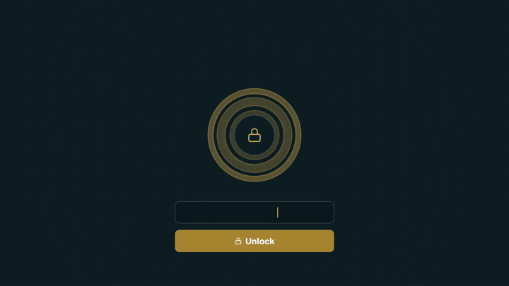

# VaultSecure

**A password manager that keeps everything on your device.** No account, no server, no one else's cloud. Your passwords are encrypted in your browser before they're ever stored.

<p align="center">
  <a href="docs/media/vaultsecure-demo.mp4">
    
  </a>
  <br>
  <a href="docs/media/vaultsecure-demo.mp4"><strong>▶ Watch the full video (21 s)</strong></a>
</p>

**[English](#english)** · **[Português](#português)**

---

## English

### What it does

VaultSecure stores your logins, cards, secure notes and API keys in an encrypted vault that lives only on your device. It runs in the browser, installs as an app (PWA or desktop), and works offline.

- **Three separate vaults:** Personal, Work and Shared, each with its own items.
- **Import from your browser:** bring in the passwords saved in Chrome, Edge, Brave, Opera, Firefox or Safari (or a Bitwarden, LastPass or 1Password CSV). You review every row, see duplicates and weak passwords, and pick the vault for each one. Nothing already in your vault is changed or removed.
- **Vault health:** a score out of 100 and a list of what to fix first: leaked, weak and reused passwords. The online breach check uses Have I Been Pwned with k-anonymity, so your password never leaves the device.
- **Sync between devices without a server:** choose a folder you already sync (Syncthing, OneDrive, Google Drive, Dropbox) and VaultSecure keeps an encrypted file there, up to date. Edits, new items and deletions reach your other devices.
- **Backups:** export one vault or all of them to an encrypted `.vault` file, and restore it on another device, even on the very first screen, before creating a vault.
- **Password generator:** long random passwords or easy-to-type passphrases.
- **Extra protection:** two-step verification (TOTP), an optional X.509 digital certificate to unlock, auto-lock when idle, clipboard auto-clear, a limit on wrong attempts, and a duress password that opens a decoy vault.
- **English and Portuguese**, chosen the first time you open your vault and changeable in Settings. Four themes and six accent colors.

### How your data is protected

- **Zero-knowledge.** Your master password is never stored or sent anywhere. If you forget it, no one can recover the vault.
- **Key derivation:** PBKDF2 (HMAC-SHA256, 600,000 iterations) with a random 16-byte salt per vault.
- **Encryption:** AES-256-GCM with a fresh 96-bit IV for every save, using the browser's Web Crypto API.
- **Sync and backup files** are encrypted the same way. Anyone who gets the file sees only random bytes.

### Getting started

Requirements: **Node.js 18+** and npm.

```bash
git clone https://github.com/itsbravos/VaultSecure.git
cd VaultSecure
npm install
npm run dev        # http://localhost:3000
```

The first screen lets you **create a vault** or **restore a backup** from another device. After that, a short tour shows where everything is.

#### Install it as an app

- **PWA (Windows, macOS, Linux, Android):** build and preview, then use the install icon in Chrome or Edge's address bar.
  ```bash
  npm run build
  npm run preview    # http://localhost:4173
  ```
  Browsers only allow installing and offline caching over **HTTPS** or on **localhost**.
- **GitHub Pages:** the included workflow (`.github/workflows/deploy-pages.yml`) publishes the app on every push to `main`. Turn it on once in **Settings › Pages › Source: GitHub Actions**, then open the HTTPS address on your phone and choose **Install app**.
- **Desktop app (Electron):**
  ```bash
  npm run electron:dev             # Electron window with hot reload
  npm run electron:build           # installer for the current OS, in release/
  npm run electron:build:win       # .exe (NSIS)
  npm run electron:build:mac       # .dmg
  npm run electron:build:linux     # AppImage
  ```

### Import your passwords from the browser

1. Go to **Backup › Import passwords from your browser** (or **Import from browser** on the home screen).
2. Pick your browser. The app shows where its export option is. In Chrome, for example, open `chrome://password-manager/settings` and choose **Export passwords**.
3. Drop the `.csv` file in, review the rows, choose a vault for each one and import.
4. **Delete the exported `.csv` afterwards.** It contains every password unencrypted.

### Sync between devices

- **Chrome or Edge on a computer (automatic):** in **Settings › Sync between devices**, click **Choose folder** and pick a folder that's already synced. Do the same on your other computers. The first time a second device connects, it asks for the master password used on the first one, once, to link them.
- **Phones, Firefox and Safari (manual):** these browsers can't access folders, so use **Merge file** to bring in the sync file and **Download updated file** to send your changes back.

### Tests

```bash
npm test               # run once
npm run test:watch
npm run test:coverage
```

The suite covers the encryption (PBKDF2, AES-GCM round trips), the browser CSV importer, the sync merge, and a two-device sync simulation with real encryption.

### License

[MIT](LICENSE)

---

## Português

### O que o app faz

O VaultSecure guarda seus logins, cartões, notas seguras e chaves de API num cofre criptografado que fica só no seu aparelho. Ele roda no navegador, pode ser instalado como aplicativo (PWA ou desktop) e funciona offline.

- **Três cofres separados:** Pessoal, Trabalho e Compartilhado, cada um com seus itens.
- **Importação do navegador:** traga as senhas salvas no Chrome, Edge, Brave, Opera, Firefox ou Safari (ou um CSV do Bitwarden, LastPass ou 1Password). Você revisa cada linha, vê duplicados e senhas fracas e escolhe o cofre de cada uma. Nada que já está no cofre é alterado ou apagado.
- **Saúde do cofre:** uma nota de 0 a 100 e a lista do que corrigir primeiro: senhas vazadas, fracas e repetidas. A verificação online usa o Have I Been Pwned com k-anonimato, então sua senha nunca sai do aparelho.
- **Sincronização entre aparelhos sem servidor:** escolha uma pasta que você já sincroniza (Syncthing, OneDrive, Google Drive, Dropbox) e o VaultSecure mantém lá um arquivo criptografado sempre atualizado. Edições, novos itens e exclusões chegam aos outros aparelhos.
- **Backups:** exporte um cofre ou todos para um arquivo `.vault` criptografado e restaure em outro aparelho, inclusive já na primeira tela, antes de criar um cofre.
- **Gerador de senhas:** senhas aleatórias longas ou frases fáceis de digitar.
- **Proteções extras:** verificação em duas etapas (TOTP), certificado digital X.509 opcional para desbloquear, bloqueio automático por inatividade, limpeza automática da área de transferência, limite de tentativas erradas e uma senha de coação que abre um cofre de fachada.
- **Inglês e português**, escolhidos na primeira vez que você abre o cofre e alteráveis nas Configurações. Quatro temas e seis cores de destaque.

### Como seus dados são protegidos

- **Zero-knowledge.** Sua senha mestra nunca é guardada nem enviada. Se você esquecê-la, ninguém consegue recuperar o cofre.
- **Derivação da chave:** PBKDF2 (HMAC-SHA256, 600.000 iterações) com salt aleatório de 16 bytes por cofre.
- **Criptografia:** AES-256-GCM com um IV novo de 96 bits a cada gravação, usando a Web Crypto API do navegador.
- **Arquivos de sincronização e de backup** usam a mesma criptografia. Quem pegar o arquivo vê apenas bytes aleatórios.

### Como começar

Requisitos: **Node.js 18+** e npm.

```bash
git clone https://github.com/itsbravos/VaultSecure.git
cd VaultSecure
npm install
npm run dev        # http://localhost:3000
```

A primeira tela permite **criar um cofre** ou **restaurar um backup** de outro aparelho. Depois disso, um tour rápido mostra onde fica cada coisa.

#### Instalar como aplicativo

- **PWA (Windows, macOS, Linux, Android):** gere o build e rode o preview; depois use o ícone de instalar na barra de endereço do Chrome ou do Edge.
  ```bash
  npm run build
  npm run preview    # http://localhost:4173
  ```
  O navegador só permite instalar e usar o cache offline em **HTTPS** ou em **localhost**.
- **GitHub Pages:** o workflow incluído (`.github/workflows/deploy-pages.yml`) publica o app a cada push na `main`. Ative uma vez em **Settings › Pages › Source: GitHub Actions**, abra o endereço HTTPS no celular e escolha **Instalar aplicativo**.
- **App desktop (Electron):**
  ```bash
  npm run electron:dev             # janela Electron com hot reload
  npm run electron:build           # instalador para o sistema atual, em release/
  npm run electron:build:win       # .exe (NSIS)
  npm run electron:build:mac       # .dmg
  npm run electron:build:linux     # AppImage
  ```

### Importar as senhas do navegador

1. Vá em **Backup › Importar senhas do navegador** (ou **Importar do navegador** na tela inicial).
2. Escolha o navegador. O app mostra onde fica a opção de exportar. No Chrome, por exemplo, abra `chrome://password-manager/settings` e escolha **Exportar senhas**.
3. Arraste o arquivo `.csv`, revise as linhas, escolha o cofre de cada uma e importe.
4. **Apague o `.csv` exportado depois.** Ele contém todas as senhas sem criptografia.

### Sincronizar entre aparelhos

- **Chrome ou Edge no computador (automático):** em **Configurações › Sincronizar entre aparelhos**, clique em **Escolher pasta** e selecione uma pasta que já sincroniza. Faça o mesmo nos outros computadores. Na primeira vez em que um segundo aparelho se conecta, ele pede a senha mestra usada no primeiro, uma única vez, para vincular os dois.
- **Celular, Firefox e Safari (manual):** esses navegadores não acessam pastas. Use **Mesclar arquivo** para trazer o arquivo de sincronização e **Baixar arquivo atualizado** para levar suas mudanças de volta.

### Testes

```bash
npm test               # roda uma vez
npm run test:watch
npm run test:coverage
```

Os testes cobrem a criptografia (PBKDF2, ida e volta do AES-GCM), o importador de CSV do navegador, a mesclagem do sync e uma simulação de sincronização entre dois aparelhos com criptografia real.

### Licença

[MIT](LICENSE)
